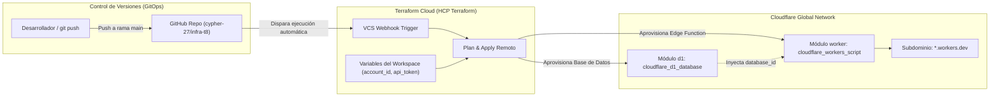

# Tarea 8: Despliegue de Infraestructura Serverless con Terraform Cloud y Módulos

[](https://www.terraform.io/)
[](https://workers.cloudflare.com/)
[](https://app.terraform.io/)
[](https://github.com/)

Proyecto de **Infraestructura como Código (IaC)** desarrollado para la materia de **Infraestructura y Desarrollo Continuo** en el **ITESO**. Consiste en la refactorización modular de la Práctica 11 (Cloudflare Workers & Cloudflare D1) y su automatización GitOps mediante **Terraform Cloud (HCP Terraform)** vinculado a este repositorio de GitHub.

---

## 🏗️ Arquitectura de la Solución



---

## 📁 Estructura Modular del Proyecto

El código fuente fue refactorizado siguiendo los principios de modularidad, alta cohesión y bajo acoplamiento:

```text
infra-t8/
├── .gitignore                  # Exclusión de archivos de estado y credenciales
├── .terraform.lock.hcl         # Lockfile determinista de proveedores
├── versions.tf                 # Declaración de proveedores requeridos (cloudflare ~> 5.0)
├── variables.tf                # Definición de variables raíz
├── main.tf                     # Invocación y orquestación de módulos
├── outputs.tf                  # Salidas expuestas al workspace de Terraform Cloud
├── terraform.tfvars.example    # Plantilla de variables sin datos sensibles
├── README.md                   # Documentación general del repositorio
├── capturas/                   # Evidencias para el reporte
└── modules/
    ├── d1/                     # Módulo para Cloudflare D1 (Base de Datos Relacional)
    │   ├── README.md           # Documentación del módulo D1
    │   ├── versions.tf         # Proveedores requeridos
    │   ├── variables.tf        # Variables de entrada
    │   ├── main.tf             # Recurso cloudflare_d1_database
    │   └── outputs.tf          # database_id y database_name
    └── worker/                 # Módulo para Cloudflare Worker & Subdominio
        ├── README.md           # Documentación del módulo Worker
        ├── versions.tf         # Proveedores requeridos
        ├── variables.tf        # Variables de entrada (incluye d1_database_id)
        ├── main.tf             # Recursos cloudflare_workers_script y subdomain
        ├── outputs.tf          # worker_id, worker_name y worker_url
        └── worker.js           # Lógica JavaScript en Node.js/V8 para el Edge
```

---

## 🚀 Despliegue en Terraform Cloud

### 1. Variables Requeridas en el Workspace
Dentro de **Terraform Cloud -> Workspace -> Variables -> Terraform Variables**, configurar:

| Variable | Tipo | Sensible | Descripción |
| :--- | :---: | :---: | :--- |
| `account_id` | Terraform | No | Account ID de tu cuenta de Cloudflare |
| `api_token` | Terraform | **Sí (Sensitive)** | Token de API con permisos `Workers Scripts: Edit` y `D1: Edit` |
| `worker_name` | Terraform | No | Nombre del worker (e.g. `tarea8-worker`) |
| `d1_database_name` | Terraform | No | Nombre de la base de datos (e.g. `tarea8-db`) |

### 2. Flujo de Trabajo VCS (GitOps)
1. Al realizar cualquier `git push` a la rama `main`, Terraform Cloud detecta el cambio automáticamente.
2. Inicia una ejecución de tipo **Plan**.
3. Dependiendo de la configuración del workspace (automático o manual), ejecuta el **Apply**.
4. Al completarse, expone en los *Outputs* del workspace la URL pública del Worker en `*.workers.dev`.

---

## 🧪 Verificación

Una vez que el despliegue finaliza con estado **Apply Finished**, puedes verificar el servicio ejecutando:

```bash
curl -s https://<tu-worker>.<tu-subdominio>.workers.dev
```

La respuesta confirma la conexión con la base de datos SQLite serverless de Cloudflare D1 y el incremento del conteo de visitas en cada solicitud HTTP `GET`.
