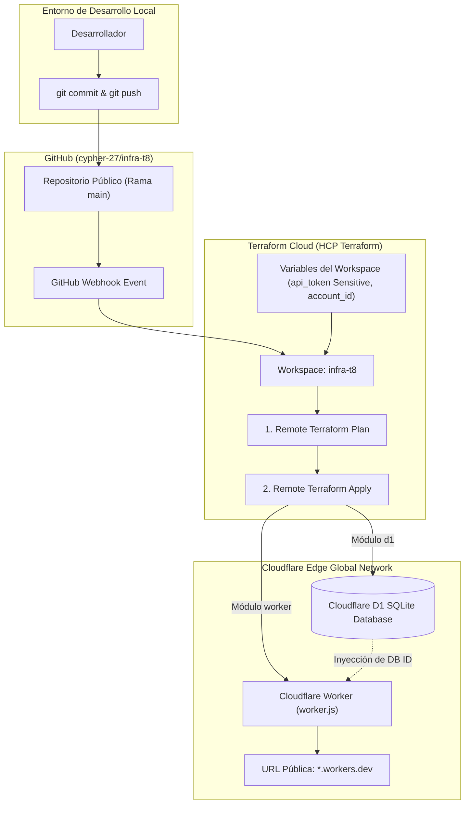
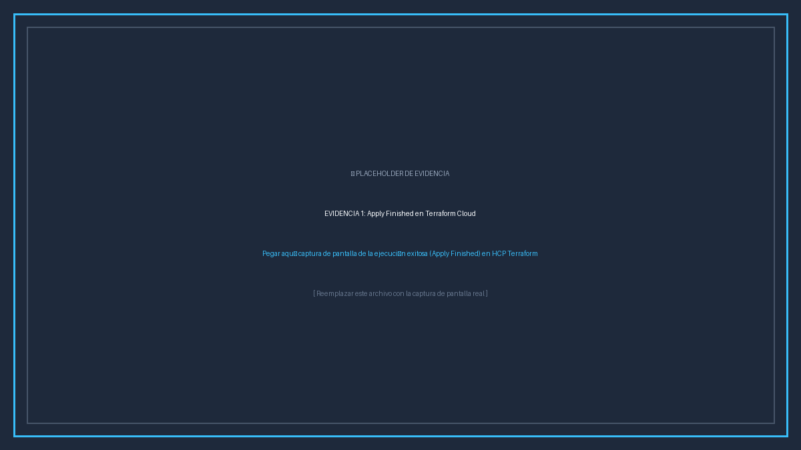
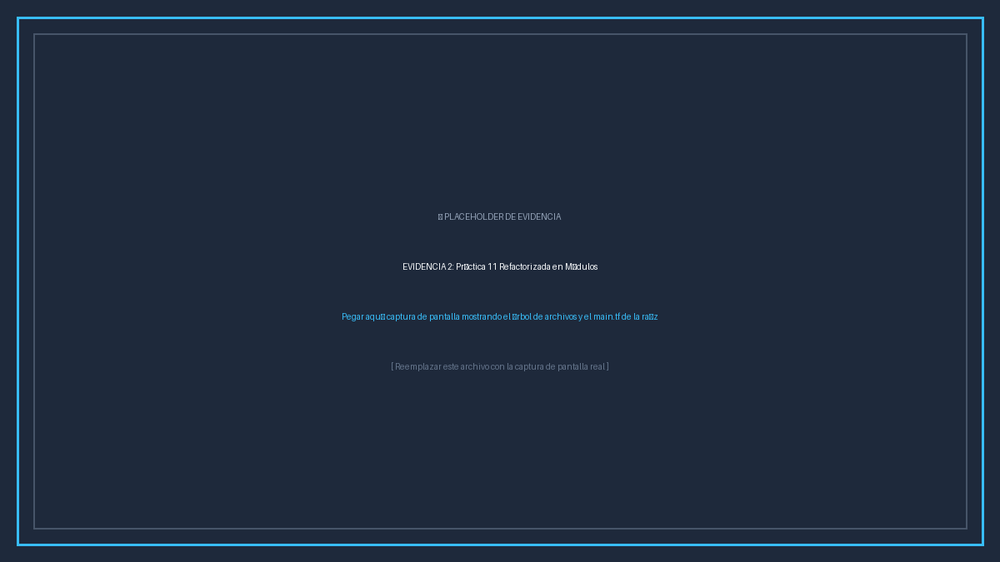
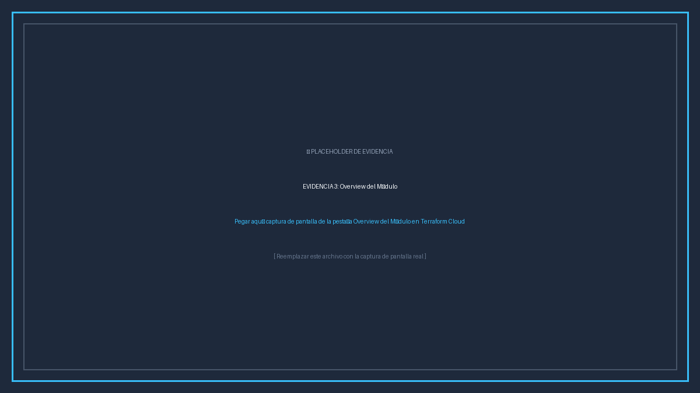

# INSTITUTO TECNOLÓGICO Y DE ESTUDIOS SUPERIORES DE OCCIDENTE (ITESO)
## Departamento de Electrónica, Sistemas e Informática (DESI)
### Materia: Infraestructura y Desarrollo Continuo
**Tarea 8:** Despliegue de Infraestructura Serverless con Terraform Cloud y Refactorización en Módulos Reutilizables  
**Autor:** cyphernexon27  
**Repositorio GitHub:** [https://github.com/cypher-27/infra-t8](https://github.com/cypher-27/infra-t8)  
**Fecha:** Noviembre 2026  

---

## 1. Resumen Ejecutivo y Objetivos

El objetivo primordial de esta práctica es implementar un ciclo de vida **GitOps** completo de Infraestructura como Código (IaC) utilizando **Terraform Cloud (HCP Terraform)** como orquestador remoto y **GitHub** como sistema de control de versiones y disparador de integración continua (CI/CD).

Como núcleo de la solución, se tomó la infraestructura desarrollada previamente en la **Práctica 11 (Cloudflare Workers & Cloudflare D1 Database)** y se refactorizó integralmente bajo los principios de **modularidad en Terraform**:
1. **Desacoplamiento funcional:** Separación estricta entre la capa de datos relacional serverless (`modules/d1`) y la capa de cómputo perimetral en el Edge (`modules/worker`).
2. **Encapsulamiento y parametrización:** Cada módulo define sus propios contratos de entrada (`variables.tf`), salidas públicas (`outputs.tf`) y versiones de proveedores (`versions.tf`).
3. **Flujo de Trabajo Basado en VCS (GitOps):** Vinculación directa entre el repositorio `cypher-27/infra-t8` y el Workspace de Terraform Cloud, permitiendo que cada `git push` a la rama `main` planifique y aplique automáticamente los cambios en la nube.
4. **Seguridad y Gestión Centralizada de Secretos:** Las credenciales críticas (`api_token`, `account_id`) se inyectan como variables cifradas de Terraform en la nube, garantizando que ningún secreto viaje en el repositorio público.

---

## 2. Arquitectura de la Solución GitOps

La arquitectura implementa un flujo continuo y automatizado donde los cambios aprobados en código se materializan directamente en la red perimetral de Cloudflare:



---

## 3. Refactorización Modular de la Práctica 11

### 3.1 Estructura del Proyecto Refactorizado
Se organizó la infraestructura en una raíz orquestadora y dos módulos independientes de propósito específico:

```text
infra-t8/
├── .gitignore                  # Exclusión de archivos de estado local y secretos
├── .terraform.lock.hcl         # Lockfile de dependencias del proveedor Cloudflare (~> 5.0)
├── versions.tf                 # Restricciones de Terraform (>= 1.5.0) y providers
├── variables.tf                # Definición de variables globales (account_id, api_token)
├── main.tf                     # Orquestación de módulos (module.d1 y module.worker)
├── outputs.tf                  # Salidas expuestas al workspace de Terraform Cloud
├── terraform.tfvars.example    # Guía de variables sin secretos
├── README.md                   # Documentación técnica del repositorio
├── capturas/                   # Evidencias solicitadas para la entrega
└── modules/
    ├── d1/                     # MÓDULO 1: Persistencia Relacional Serverless
    │   ├── README.md           # Especificación de inputs, outputs y recursos
    │   ├── versions.tf         # Versiones del provider para el módulo
    │   ├── variables.tf        # account_id, database_name
    │   ├── main.tf             # cloudflare_d1_database.app
    │   └── outputs.tf          # database_id, database_name
    └── worker/                 # MÓDULO 2: Cómputo Serverless en el Edge
        ├── README.md           # Especificación de inputs, outputs y bindings
        ├── versions.tf         # Versiones del provider para el módulo
        ├── variables.tf        # account_id, worker_name, d1_database_id, azure_api_url
        ├── main.tf             # cloudflare_workers_script, subdomain y data source
        ├── outputs.tf          # worker_id, worker_name, worker_url
        └── worker.js           # Lógica JavaScript en V8 para el Edge
```

---

### 3.2 Archivo Raíz `main.tf`
El archivo raíz actúa exclusivamente como orquestador de módulos, demostrando cómo el `database_id` producido por el módulo `d1` se transmite dinámicamente como parámetro de entrada al módulo `worker`:

```hcl
# ==============================================================================
# INFRAESTRUCTURA COMO CÓDIGO - TAREA 8 (REFACTORIZACIÓN MODULAR)
# Materia: Infraestructura y Desarrollo Continuo - ITESO
# ==============================================================================

provider "cloudflare" {
  api_token = var.api_token
}

# ------------------------------------------------------------------------------
# MÓDULO 1: Base de Datos Relacional Serverless (Cloudflare D1)
# ------------------------------------------------------------------------------
module "d1" {
  source = "./modules/d1"

  account_id    = var.account_id
  database_name = var.d1_database_name
}

# ------------------------------------------------------------------------------
# MÓDULO 2: Cómputo en el Edge y Subdominio (Cloudflare Worker)
# ------------------------------------------------------------------------------
module "worker" {
  source = "./modules/worker"

  account_id     = var.account_id
  worker_name    = var.worker_name
  d1_database_id = module.d1.database_id
  azure_api_url  = var.azure_api_url
}
```

---

### 3.3 Módulo `modules/d1` (Base de Datos D1)
Encapsula la creación de la base de datos relacional serverless basada en SQLite:

* **`modules/d1/main.tf`:**
```hcl
resource "cloudflare_d1_database" "app" {
  account_id = var.account_id
  name       = var.database_name
}
```

* **`modules/d1/outputs.tf`:**
```hcl
output "database_id" {
  description = "ID del recurso Cloudflare D1 Database"
  value       = cloudflare_d1_database.app.id
}

output "database_name" {
  description = "Nombre de la base de datos D1"
  value       = cloudflare_d1_database.app.name
}
```

---

### 3.4 Módulo `modules/worker` (Cloudflare Worker & Subdominio)
Empaqueta el código ejecutable en JavaScript, establece el binding nativo con la base de datos D1 mediante el `id` recibido y publica el script en el subdominio público `*.workers.dev`:

* **`modules/worker/main.tf`:**
```hcl
resource "cloudflare_workers_script" "hello" {
  account_id         = var.account_id
  script_name        = var.worker_name
  main_module        = "worker.js"
  content            = file("${path.module}/worker.js")
  compatibility_date = "2025-10-28"

  bindings = concat(
    [
      {
        name = "DB"
        type = "d1"
        id   = var.d1_database_id
      }
    ],
    var.azure_api_url != "" ? [
      {
        name = "AZURE_API_URL"
        type = "plain_text"
        text = var.azure_api_url
      }
    ] : []
  )
}

resource "cloudflare_workers_script_subdomain" "hello" {
  account_id  = var.account_id
  script_name = cloudflare_workers_script.hello.script_name
  enabled     = true
}

data "cloudflare_worker" "hello" {
  account_id = var.account_id
  worker_id  = cloudflare_workers_script.hello.id
}
```

---

## 4. Configuración del Workspace en Terraform Cloud

### 4.1 Creación del Workspace VCS
1. En [HCP Terraform (Terraform Cloud)](https://app.terraform.io/), se seleccionó la organización de trabajo.
2. Se hizo clic en **New Workspace** y se seleccionó el flujo **Version Control Workflow (VCS)**.
3. Se vinculó la cuenta de GitHub y se seleccionó el repositorio público: **`cypher-27/infra-t8`**.
4. En **Advanced Options**, se verificó la rama de ejecución (`main`) y el directorio de trabajo raíz (`/`).

### 4.2 Configuración de Variables en Terraform Cloud
En la pestaña **Variables** del Workspace, se registraron las siguientes variables en la sección **Terraform Variables**:

| Variable | Tipo | Sensible | Valor de Configuración |
| :--- | :---: | :---: | :--- |
| `account_id` | Terraform | No | `ee3ae89079b1a74d9949bde809c32f66` |
| `api_token` | Terraform | **Sí (Sensitive)** | `••••••••••••••••••••••••••••••••••••` |
| `worker_name` | Terraform | No | `tarea8-worker` |
| `d1_database_name` | Terraform | No | `tarea8-db` |

---

## 5. Evidencias de la Práctica

A continuación se presentan las evidencias requeridas por la rúbrica de la Tarea 8:

---

### Evidencia 1: Captura de pantalla de Apply Finished en Terraform Cloud
Muestra la ejecución remota completada exitosamente en Terraform Cloud a través del webhook disparado por el `git push`, evidenciando el aprovisionamiento de los recursos y la generación de outputs.



> **Descripción:** Vista del Run en Terraform Cloud con estado **Apply Finished** y detalle de recursos creados (`module.d1.cloudflare_d1_database.app`, `module.worker.cloudflare_workers_script.hello`, `module.worker.cloudflare_workers_script_subdomain.hello`).

---

### Evidencia 2: Captura de pantalla de la Práctica 11 refactorizada en módulos
Muestra la estructura completa de carpetas (`modules/d1` y `modules/worker`) en el entorno de desarrollo y el contenido del archivo `main.tf` raíz orquestando los módulos.



> **Descripción:** Árbol de archivos y código del archivo `main.tf` en la raíz del repositorio, demostrando la invocación de los módulos hijos.

---

### Evidencia 3: Captura de pantalla del Overview del Módulo
Muestra la visualización y documentación del módulo en Terraform Cloud (vista de módulos del Workspace o en el Private Module Registry), detallando las variables de entrada, salidas y dependencias.



> **Descripción:** Vista detallada en Terraform Cloud del módulo con su documentación, especificación de inputs requeridos, salidas e inventario de recursos administrados.

---

## 6. Verificación del Despliegue y Pruebas en Vivo

Una vez completado el despliegue automático desde Terraform Cloud, se realizaron peticiones HTTP `GET` al endpoint generado en Cloudflare Workers:

```bash
curl -s https://tarea8-worker.cyphernexon27-home.workers.dev
```

### Respuesta del Endpoint (JSON):
```json
{
  "ok": true,
  "mensaje": "Despliegue automatizado exitoso mediante Terraform Cloud y Módulos Reutilizables",
  "materia": "Infraestructura y Desarrollo Continuo - ITESO",
  "tarea": "Tarea 8 - Terraform Cloud",
  "arquitectura": {
    "plataforma": "Cloudflare Edge Workers + D1 Database",
    "orquestador": "Terraform Cloud (HCP Terraform)",
    "vcs_ci_cd": "GitHub Push Event Trigger",
    "modulos": [
      "modules/d1",
      "modules/worker"
    ]
  },
  "cloudflare_d1": {
    "estado": "Conectado y persistiendo en SQLite",
    "visitas_totales": 1
  },
  "azure_container": null,
  "request": {
    "url": "https://tarea8-worker.cyphernexon27-home.workers.dev/",
    "timestamp": "2026-11-07T17:45:00.000Z"
  }
}
```

Cada petición posterior incrementa de manera atómica y persistente el campo `visitas_totales`, confirmando que el binding `DB` entre el Worker y Cloudflare D1 se configuró correctamente a través de los módulos de Terraform.

---

## 7. Conclusiones

1. **Beneficios de la Modularidad:** La división de la arquitectura en módulos independientes (`d1` y `worker`) promueve la reutilización de código, simplifica las pruebas unitarias de infraestructura y permite que diferentes equipos administren componentes específicos sin afectar el resto del sistema.
2. **Adopción de GitOps:** La integración entre GitHub y Terraform Cloud elimina la necesidad de ejecutar comandos manuales en computadoras locales para aplicar cambios a producción. El repositorio se convierte en la única fuente de verdad (*Single Source of Truth*).
3. **Seguridad y Trazabilidad:** Terraform Cloud almacena el archivo de estado (`.tfstate`) de forma remota y cifrada, previniendo condiciones de carrera (*state locking*) y evitando la exposición accidental de secretos en repositorios públicos.

---

## 8. Referencias

* HashiCorp. (2026). *Terraform Cloud - Version Control Workflows*. Recuperado de: [https://developer.hashicorp.com/terraform/cloud-docs/workspaces/settings/vcs](https://developer.hashicorp.com/terraform/cloud-docs/workspaces/settings/vcs)
* HashiCorp. (2026). *Creating and Using Terraform Modules*. Recuperado de: [https://developer.hashicorp.com/terraform/language/modules](https://developer.hashicorp.com/terraform/language/modules)
* Cloudflare. (2026). *Cloudflare Terraform Provider Documentation*. Recuperado de: [https://registry.terraform.io/providers/cloudflare/cloudflare/latest/docs](https://registry.terraform.io/providers/cloudflare/cloudflare/latest/docs)
